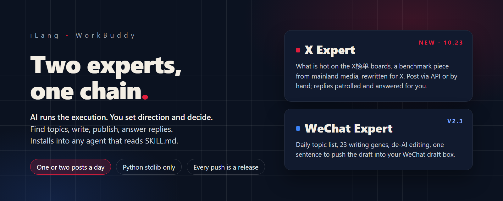

<p align="center">
  <picture>
    <source media="(max-width: 767px)" srcset="https://raw.githubusercontent.com/adsorgcn/WorkBuddy/main/docs/hero-mobile-en-2026-10-23.png">
    
  </picture>
</p>

<p align="center">
  <a href="README.md">中文</a>&nbsp;&nbsp;·&nbsp;&nbsp;<a href="HOT-LIST.md">Today's topic list</a>&nbsp;&nbsp;·&nbsp;&nbsp;<a href="https://github.com/adsorgcn/WorkBuddy/releases">Releases</a>&nbsp;&nbsp;·&nbsp;&nbsp;<a href="UPDATES.md">Updates</a>
</p>

<p align="center">
  <a href="https://github.com/adsorgcn/WorkBuddy/releases"></a>
  <a href="https://github.com/adsorgcn/WorkBuddy/actions/workflows/update-hot-list.yml"></a>
  <a href="LICENSE"></a>
</p>

<br>

**AI runs the execution. You set direction and decide.** Two experts live in this repository, each with its own chain: find topics, write, publish, answer replies. Skills are standard `SKILL.md` plus stdlib Python: WorkBuddy, Claude Code, Codex, Muse, Hermes, OpenClaw, Doubao and any agent that reads skill files can install them.

| | X expert <sub>new on 23 Oct</sub> | WeChat expert |
|---|---|---|
| For&nbsp;whom | People who want AI to run an X (Twitter) account | People who write a WeChat Official Account |
| Topics&nbsp;from | The public X榜单 boards for what is hot today, then a benchmark piece on WeChat, Zhihu, Bilibili, Douyin or Xiaohongshu | 40+ hot sources pulled every day, plus real WeChat read and share numbers from wxrank |
| It&nbsp;does | Rewrites, posts, patrols the replies under your own posts and answers them | Writes, makes the cover prompt, pushes the draft, reads the numbers back |
| You&nbsp;do | State your positioning once; pick a topic and nod each time | Pick the topic, review the draft, tap publish on your phone |
| Cost | Manual posting is free; the API route starts at $5 plus $5 matched | wxrank credit only, one hot-list query = 1 credit |
| Install | GitHub, any agent that reads SKILL.md | One click in the domestic WorkBuddy marketplace, or any agent |

<br>

## The X expert

For people who want AI to run the execution of an X (Twitter) account while they keep the judgment. Tell it your positioning; it picks topics, writes posts, threads and long posts, publishes, patrols the replies under your own posts and answers them. You set direction and decide.

**Topic logic** is the same benchmark idea as the WeChat expert, in the other direction: first the public [X榜单](https://xbangdan.com/) boards for what is hot today and in which format, then a benchmark piece on mainland Chinese media (WeChat, Zhihu, Bilibili, Douyin, Xiaohongshu), rewritten into an X post with the images and video reused. Topic data comes first from the public boards (free; a stdlib script parses the four board pages), then from this repository's free daily list; the X榜单 MCP is optional, for filtering its 30-day database.

**Publishing is your choice**: through the official X API on your own pay-per-use credits ($0.015 per post, $0.20 with a URL), or by hand through an intent link that fills the x.com compose box for you to click, at no cost. Reply patrol goes through the official API and only answers people who replied to, mentioned or quoted you.

### How a beginner uses it

Before the first run, three things:

1. An AI agent that reads skill files: Claude Code, Codex, Muse or the international WorkBuddy. Paste the install command below into it; it installs itself and reports back.
2. Decide how to publish. By hand: free, the expert fills the x.com compose box and you click Post. Through the API: create an app at developer.x.com with Read and write permission, generate the four keys, put them in `~/.x-api.env`; buy $5 of credits (X matches it with $5); run `check` and look for "read-write". If the app was read-only first, regenerate the Access Token after changing the permission.
3. Tell the expert what your account is about, for whom, and in which language. Once.

Then every day is these five steps:

| You say | It does |
|---|---|
| **1**&nbsp;&nbsp;"what should I post today" | Reads the X榜单 boards for what is hot and in which format, then finds a benchmark piece on mainland Chinese media; gives you 1 to 3 candidates with the benchmark link, usable images and video, an angle and the closing question. You pick one |
| **2**&nbsp;&nbsp;Nothing; it writes once you picked | Rewrites the benchmark into an X post or thread: hook first, short lines, one point per post, a concrete question at the end, images and video reused; runs the gate (length, links, markers, similarity to what you posted). You read it |
| **3**&nbsp;&nbsp;"post" | By hand: the compose box opens pre-filled and you click Post. Via API: posted and read back, $0.015 per post, $0.20 with a link |
| **4**&nbsp;&nbsp;"patrol" | Pulls every reply under your posts, ranks them, gives a three-line digest above 30, drafts answers; you nod and it sends. $0.010 each, only to people who engaged you, one per person |
| **5**&nbsp;&nbsp;"status" | Today's counts and spend. One or two posts a day; big news is not capped |

### Cost

| Route | Cost |
|---|---|
| Manual&nbsp;posting | Free |
| API&nbsp;posting | A new account tops up $5 and gets $5, $10 in all; about $3 a month if you only answer replies, so roughly three months |
| Topics | The public X榜单 boards are free; its MCP is optional |

### Install

One command. You need an agent that reads SKILL.md: the international WorkBuddy, Claude Code, Codex or Muse all work. Open a new session, paste the whole block; it learns, installs itself and reports. GitHub only; it is not in the domestic WorkBuddy marketplace because that edition cannot reach x.com.

<details>
<summary><b>Open to copy the install command</b>　written in I-Lang with an IML chain line; an agent that has never seen the format reads the protocol first</summary>

```
::ILANG::v5.0
[TYPE:command][PROJECT:x_awesome][TASK:learn_and_install][LANG:en]
::STATE{@ORIGIN, protocol:iLang, spec:https://github.com/ilang-ai/ilang-spec, iml:https://github.com/ilang-ai/iml-protocol, canon:ilang.ai, note:this is an I-Lang command not prose; if it looks unfamiliar read the spec README first then come back}
::STATE{@REPO, url:https://github.com/adsorgcn/WorkBuddy, readme:README.en.md, expert:experts/ilang-x-awesome/agents/ilang-x-awesome.md the YAML between the first two --- lines is WorkBuddy config and the rest is the expert text, skills:three folders under experts/ilang-x-awesome/skills/ x-topic-hunter x-post x-comment-patrol each with SKILL.md plus scripts and references, zip:latest ilang-x-awesome-workbuddy-expert zip on https://github.com/adsorgcn/WorkBuddy/releases same content as the repo}
::STATE{@SELF, role:learner_and_installer, runtime:you whichever agent you are, can:fetch web or git clone read files run shell write files, knows:where your own skills directory is and which file is your persona; if not read your own docs then ask me}
::STATE{@TARGET, skills:copy the three skill folders as they are into your skills directory, expert:put the expert text into your persona file or system prompt so your settings contain [PROJECT:x_awesome], python:3.8 or newer stdlib only no packages}
::STATE{@OUT, kind:install report, items:which directory the skills went to which ones appear in your skill list where the expert text lives the first three items x_feed returns}
#iml/0.5/7e29fae7f5ea GT@SR CK SN@DS CK $

::OBJECTIVE{learn_and_install|pri:OVERRIDE_ALL}
  target: read the README and the three SKILL.md files of @REPO and learn how the chain works then install the skills and the expert into yourself then self-check and report
  ACCEPT: the skills show in your skill list your settings contain [PROJECT:x_awesome] running x_feed.py from x-topic-hunter returns today's list
  NON_GOALS: edit any file in the package touch any of my keys register or pay for anything on my behalf post anything

::RULE{getting the package⇒git clone or download the zip from @REPO; if this machine cannot reach GitHub stop and tell me I will download it and give you the path}
::RULE{desktop apps that cannot take files such as WorkBuddy⇒tell me to upload the skills in the Skills panel and create an expert from the expert text named X运营专家}
::RULE{persona⇒paste the expert text whole without edits; if you already have a persona append it as a section}
::BOUNDARY{never:modify any file inside the package|scope:permanent}
::BOUNDARY{never:write any key or password into the chat|scope:permanent}

::MODULE{HOW}
  [STEP:1:LEARN] read the README and the three SKILL.md files; restate the chain in three sentences and say where the human decides
  [STEP:2:GET] get the package; list the paths of the expert text and the three skill folders
  [STEP:3:SKILLS] install into your skills directory; open a new session and report which skills appear
  [STEP:4:EXPERT] put the expert text into your persona; report where
  [STEP:5:CHECK] run x_feed.py --n 3 and report the three items
  [STEP:6:REPORT] report per @OUT and ask me whether posting goes through the API or by hand
```

</details>

No agent runtime yet? Install one that reads SKILL.md first. Tutorials: follow [@ai_chuhai](https://x.com/ai_chuhai) on X; start with [the X beginner guide](https://x.com/ai_chuhai/status/2112640526176358616) and [the X algorithm formula](https://x.com/ai_chuhai/status/2113358982391750858).

### What it never does

Never touches politics or geopolitics, never likes, follows or quotes, never posts trending topics automatically, never comments on strangers' posts, never scripts the X website, keeps to one or two posts a day, never shares your keys.

<br>

## The WeChat expert

Most "AI writes your WeChat article" tools only write. This is a chain: a topic list that updates itself every day tells you what every platform is talking about, real read and share numbers from WeChat tell you which of those topics nobody has written well yet, then the AI writes, makes the cover prompt, pushes the draft into your WeChat draft box, you read it on your phone and publish, and the AI reads the numbers back and plans the next one. A human decides twice: which topic, and whether to publish.

WorkBuddy is the primary host (add the expert from the domestic marketplace). Any agent that reads `SKILL.md` can install the same skills: Claude Code, Codex, CodeBuddy CLI, Hermes, OpenClaw, Doubao, Muse and others. The only thing you pay for is wxrank API credit, which you buy yourself: https://wxrank.com/api-services

### What is different

| | Typical AI writer | Here |
|---|---|---|
| Covers | Writing | Direction, topics, content calendar, writing, images, draft push, read-back, cadence |
| Topics&nbsp;from | Your guess | Demand side: a daily list pulled from 40+ public hot sources; supply side: real WeChat read and share numbers. A topic counts when both sides agree |
| You&nbsp;do | Watches everything | Two decisions: topic and publish. Publishing is always a human act |
| Switching | Start over | Skills are standard SKILL.md plus stdlib Python; move them to another agent as they are |
| Cost | Subscriptions, models, tools | wxrank credit only: 100 credits = 1 CNY, one hot-list query = 1 credit |

### The chain

| Step | What | Tool and output |
|---|---|---|
| 1 | **Pick a direction**<br><sub>AI compares, you decide</sub> | topic hunter `direction`: 2 to 8 candidate niches, one hot-list query each<br><sub>Output · Table: hits, max read, median read, posts over 100k</sub> |
| 2 | **Find topics**<br><sub>AI finds, you decide</sub> | `feed` reads today's list for free, `hot` checks WeChat read and share numbers<br><sub>Output · 5 candidates with demand and supply data</sub> |
| 3 | **Content calendar**<br><sub>AI</sub> | `calendar`: pick, check, schedule by cadence<br><sub>Output · A month of topics with dates</sub> |
| 4 | **Write**<br><sub>AI</sub> | writing skill: 23 writing genes, 12-point self-check, de-AI editing<br><sub>Output · Markdown body, 3 titles, cover prompt, self-check report</sub> |
| 5 | **Images**<br><sub>AI prompts, you render or connect an image API</sub> | cover prompt template<br><sub>Output · cover and body images</sub> |
| 6 | **Push draft**<br><sub>AI</sub> | draft-push skill: WeChat HTML, image upload, draft/add, read-back<br><sub>Output · The draft in your draft box, media_id</sub> |
| 7 | **Review and publish**<br><sub>You</sub> | WeChat Official Account Assistant on your phone<br><sub>Output · The published link</sub> |
| 8 | **Read back**<br><sub>AI</sub> | `article` for read, like, share<br><sub>Output · One data row per article</sub> |
| 9 | **Cadence**<br><sub>AI plans, you decide</sub> | 1 to 2 posts a week, stock 2 to 3 first<br><sub>Output · Weekly plan</sub> |

Each step hands the next an I-Lang block. One machine, one agent, the whole chain; your phone remote-controls it.

### How to use it

| Step | You say or do | It&nbsp;does |
|---|---|---|
| 1 | Say "what should I write today", or paste the daily command from the topic-list section below | Reads the list, checks the numbers, gives 5 topics; you pick one and add your exclusive angle |
| 2 | Paste your material (experience, data, notes, file paths) and say "write it as a WeChat article" | Confirms the angle and the skeleton; you choose |
| 3 | Confirm | Outline and 3 titles |
| 4 | Review: add your own experience, fill the spoken-language slots, add screenshots | First draft, de-AI pass, 12-point self-check |
| 5 | Say "push the draft" | Renders WeChat HTML, uploads images, pushes into the draft box; you read it on your phone and publish |
| 6 | Give it the published link | Reads read, like and share numbers, plans the next one |

The material is other people's knowledge; the article is your view. Without an exclusive angle the expert will suggest you skip the topic.

### Install

Two routes. WorkBuddy domestic edition: one click in the marketplace. Any other agent, including the international WorkBuddy: paste one command and let it learn and install itself.

#### WorkBuddy, domestic edition (primary)

Search the marketplace for 公众号爆文专家 and add the one in the red box below: green robot avatar, tags 公众号 / 去AI味 / 推草稿箱. The similarly named 公众号爆文写作专家 next to it is someone else's.

<p align="center">
  
</p>

The marketplace version ships the writing and draft-push skills. The topic hunter is GitHub only: download the `wechat-topic-hunter` zip from [Releases](https://github.com/adsorgcn/WorkBuddy/releases), upload the folder in the Skills panel, assign it to the expert.

#### Any other agent: one command, it learns and installs itself

Claude Code, Codex, CodeBuddy CLI, Hermes, OpenClaw, Doubao, Muse, the international WorkBuddy, and whatever comes next: same command. Open a new session and paste the whole block. The agent reads the repository first to learn how the chain works, then copies the skills into its own skills directory, puts the expert text into its own persona, self-checks and reports. Whatever it cannot do itself (a desktop app that only takes uploads, say) it will tell you where to click.

<details>
<summary><b>Open to copy the install command</b>　written in I-Lang with an IML chain line; an agent that has never seen the format reads the protocol first and then understands every block in this repository</summary>

```
::ILANG::v5.0
[TYPE:command][PROJECT:wechat_awesome][TASK:learn_and_install][LANG:en]
::STATE{@ORIGIN, protocol:iLang, spec:https://github.com/ilang-ai/ilang-spec, iml:https://github.com/ilang-ai/iml-protocol, canon:ilang.ai, note:this is an I-Lang command not prose; if it looks unfamiliar read the spec README first then come back}
::STATE{@REPO, url:https://github.com/adsorgcn/WorkBuddy, readme:README.en.md, expert:experts/ilang-wechat-awesome/agents/ilang-wechat-awesome.md the YAML between the first two --- lines is WorkBuddy config and the rest is the expert text, skills:four folders under experts/ilang-wechat-awesome/skills/ each with SKILL.md plus scripts and references, feed:data/hot/latest.json the daily topic list, zip:latest ilang-wechat-awesome-workbuddy-expert zip on https://github.com/adsorgcn/WorkBuddy/releases same content as the repo}
::STATE{@SELF, role:learner_and_installer, runtime:you whichever agent you are, can:fetch web or git clone read files run shell write files, knows:where your own skills directory is and which file is your persona; if not read your own docs then ask me}
::STATE{@TARGET, skills:copy the four skill folders as they are into your skills directory at least wechat-article wechat-draft-push wechat-topic-hunter, expert:put the expert text into your persona file or system prompt so your settings contain [PROJECT:wechat_awesome], python:3.8 or newer stdlib only no packages}
::STATE{@OUT, kind:install report, items:which directory the skills went to which ones appear in your skill list where the expert text lives the five self-check lines}
#iml/0.5/7e29fae7f5ea GT@SR CK SN@DS CK $

::OBJECTIVE{learn_and_install|pri:OVERRIDE_ALL}
  target: read the README and the four SKILL.md files of @REPO and learn how the chain works then install the skills and the expert into yourself then self-check and report
  ACCEPT: the skills show in your skill list your settings contain [PROJECT:wechat_awesome] the topic skill feed command returns today's list
  NON_GOALS: edit any file in the package touch any of my keys register or pay for anything on my behalf

::RULE{getting the package⇒git clone or download the zip from @REPO; if this machine cannot reach GitHub stop and tell me I will download it and give you the path}
::RULE{skills directory⇒wherever your own docs say; after copying open a new session and check the skill list; if nothing shows tell me how to upload through the UI}
::RULE{desktop apps that cannot take files such as WorkBuddy⇒tell me to upload the skills in the Skills panel and create an expert from the expert text named 公众号爆文专家}
::RULE{persona⇒paste the expert text whole without edits; if you already have a persona append it as a section}
::BOUNDARY{never:modify any file inside the package|scope:permanent}
::BOUNDARY{never:write any key or password into the chat|scope:permanent}

::MODULE{HOW}
  [STEP:1:LEARN] read the README and the four SKILL.md files; restate the chain in three sentences and say where the human decides
  [STEP:2:GET] get the package; list the paths of the expert text and the four skill folders
  [STEP:3:SKILLS] install into your skills directory; open a new session and report which skills appear
  [STEP:4:EXPERT] put the expert text into your persona; report where
  [STEP:5:CHECK] run the topic skill feed command and report the first three items; then run the self-check block from the README, five lines
  [STEP:6:REPORT] report per @OUT and tell me what to paste next
```

</details>

If it asks where its skills directory is, the usual places: Claude Code `~/.claude/skills/`, Codex `~/.codex/skills/`, CodeBuddy CLI `~/.codebuddy/skills/`, Hermes `~/.hermes/skills/`, OpenClaw `~/.openclaw/skills/` or the workspace `skills/`; persona files are `CLAUDE.md`, `AGENTS.md`, `CODEBUDDY.md`, `SOUL.md` respectively. Doubao takes the `SKILL.md` content through "create a custom skill" in its Skills page; Muse Code reads standard `SKILL.md` folders. The international WorkBuddy's custom-model setting only accepts OpenAI-compatible endpoints. Labels in the UI win over this text; if it installs something wrong it will fix it.

#### The only thing you pay for: wxrank

Supply-side numbers come from the wxrank WeChat API on your own key. Buy credit at https://wxrank.com/api-services , register and top up at https://data.wxrank.com , 100 credits = 1 CNY, one hot-list query = 1 credit, default daily cap 300. Put the key in `.wxrank.env` in your home directory as one line `KEY=yourkey`; the script reads it, never paste it into a chat.

The API is reachable from anywhere; we tested from fourteen machines in different regions. If it fails, it is that machine's own network.

Optional second cost: an OpenAI-compatible image endpoint such as gpt-image-2 on apikey.fun if you want the AI to render covers. Without it the expert gives you the cover prompt and you render it yourself.

#### Self-check after install

Switch into the expert's conversation and paste the whole block.

<details>
<summary><b>Open to copy the self-check command</b>　five lines: expert, model, skill files, skill binding, wxrank</summary>

```
::ILANG
[TYPE:command][PROJECT:wechat_awesome][TASK:env_check][LANG:en]

::STATE{@USER, role:owner}
::STATE{@SELF, role:checker, runtime:the expert conversation, can:Read Bash Glob}
::STATE{@OUT, kind:self-check report, items:five lines expert model skill files skill binding wxrank}

::OBJECTIVE{env_check|pri:OVERRIDE_ALL}
  target: check five items; tell me how to fix what is missing; run what you can run
  ACCEPT: five lines each present or missing; last line all ready or N missing
  NON_GOALS: fill in any key for me; guess a state you did not check

::RULE{checks run commands or read files⇒never guess; what cannot run is reported as not checked}
::RULE{keys⇒only check that the file exists; never read or repeat its content}

::MODULE{HOW}
  [STEP:1] look for [PROJECT:wechat_awesome] in your own settings; if present report the version after VERSION else write missing
  [STEP:2] one sentence proving the model answers; say whether it is the built-in or a custom model
  [STEP:3] Glob for **/wechat-article/SKILL.md **/wechat-draft-push/scripts/wechat_draft.py **/wechat-topic-hunter/scripts/wxrank_topics.py; copies in Downloads or on the Desktop do not count
  [STEP:4] check whether these three skills appear in this conversation's skill list
  [STEP:5] check whether .wxrank.env exists in the home directory; if so run the topic skill balance command and report the balance else write missing
  [STEP:6] five lines: item, present or missing, how to fix
```

</details>

Read the source and permissions before installing any unofficial skill. The scripts here are pure Python stdlib and read credentials from local config files: the draft-push `wechat_draft.py` only calls the official WeChat API, its publish command is only available for verified accounts after a human says "publish", and there is no delete command; the topic hunter's `wxrank_topics.py` is read-only against wxrank and quotes before spending credits; `hot_sources.py` only reads public RSS and APIs.

### What it will not do

- No material, no article
- No invented numbers, quotes or anecdotes
- No like-and-share bait
- No URLs or personal WeChat IDs in the body
- No politics, gambling, adult content or circumvention topics
- No account farms, bulk posting or rewriting other people's articles
- No automatic publishing: a human always publishes, or says so before the API clicks the last button
- Not for evading platform disclosure rules for AI-assisted content

<br>

## Today's topic list, refreshed daily

[HOT-LIST.md](HOT-LIST.md) is for people, `data/hot/latest.json` for agents. GitHub Actions rebuilds both every morning at 06:30 Beijing time: 80+ public sources in Chinese, English, Japanese and Korean (Zhihu, Weibo, Douyin, Baidu, Bilibili, Toutiao, The Paper, Tieba, Reference News, 36Kr, Jin10, CLS, IT Home, QbitAI, SSPAI, V2EX, Hacker News, Product Hunt, TechCrunch, BBC, ITmedia, Yonhap, Google Trends for seven regions and more; sources are added and retired automatically, the current count is at the top of HOT-LIST.md), clustered across platforms so the same story on several platforms is marked, grouped into seven directions with 15 items each, items from the last 72 hours first.

Sources manage themselves: candidates that return content for a platform not yet covered are added automatically; a source that fails seven days in a row is retired and revived when it works again. Every change is logged in [UPDATES.md](UPDATES.md).

Your agent gets the list with one command a day.

<details>
<summary><b>Open to copy the daily command</b>　paste it to an agent that has the WeChat expert installed</summary>

```
::ILANG
[TYPE:command][PROJECT:wechat_awesome][TASK:daily_topics][LANG:zh]

::STATE{@FEED, url:https://raw.githubusercontent.com/adsorgcn/WorkBuddy/main/data/hot/latest.json, what:today's topics by direction; platforms = how many platforms carry it}
::STATE{@USER, niche:<your niche, one to three words>}
::STATE{@SELF, skill:wechat-topic-hunter}

::OBJECTIVE{daily_topics|pri:OVERRIDE_ALL}
  target: read @FEED with feed, pick 5 items that fit my niche, check each on WeChat with hot, give me a topic list with both sides of the data
  ACCEPT: 5 items, each with source, platform count, max WeChat read, post count, not-yet-viral marked, exclusive-angle column left for me
  NON_GOALS: pick for me, copy sources, spend credits without quoting first
```

</details>

The repository's own rhythm:

- Every day at 06:30 Beijing time it pulls 40+ sources and rewrites today's topic list: [HOT-LIST.md](HOT-LIST.md) for people, `data/hot/latest.json` for agents.
- Sources grow on their own: a candidate that returns content for a platform not yet covered is added to `sources.json`; a source that fails seven days in a row is retired and revived when it works again. Every change goes into [UPDATES.md](UPDATES.md).
- Every update ships: patch version bump, gate, zips, a GitHub release with notes generated from the commits and the day's list. New releases appear daily; install the latest.
- Your agent never scrapes anything; reading `latest.json` is enough. On a machine that cannot reach GitHub, `hot_sources.py` inside the topic skill pulls the same sources locally.

The gate: versions in sync, frontmatter complete, IML chains round-tripped through the official compiler, no em dashes, no performance claims, every referenced file present, every script compiles. Nothing ships without it.

<br>

## Skills

| Name | What | Version |
|---|---|---|
| [X&nbsp;expert](experts/ilang-x-awesome/)<br><sub>ilang-x-awesome</sub> | The expert prompt for X. Tell it your positioning; it picks topics, writes, publishes, patrols and answers replies under your own posts; one or two posts a day, no politics or geopolitics, no website scripting. Ships with the three skills below | 2.3.45 |
| [x-topic-hunter](experts/ilang-x-awesome/skills/x-topic-hunter/) | `x_rank.py` reads the public X榜单 boards (24h hottest posts, today's topics, 7-day long posts, overseas hits, free) for what is hot, then a benchmark piece is found on mainland Chinese media (WeChat, Zhihu, Bilibili, Douyin, Xiaohongshu); `x_feed.py` reads this repository's free daily list as fallback; both filtered for X: banned topics, recency, language, no repeats of what you posted. X榜单 MCP optional. Read-only | 2.3.45 |
| [x-post](experts/ilang-x-awesome/skills/x-post/) | `x_api.py`, stdlib OAuth 1.0a: check, gate (weighted 280, no markers, no em dashes, no links in body, no near-duplicates, two posts a day), post, thread, `--media` for images or video, and intent which opens the x.com compose box for manual posting. API posts are read back and logged in full locally | 2.3.45 |
| [x-comment-patrol](experts/ilang-x-awesome/skills/x-comment-patrol/) | `x_patrol.py`: fetch new replies under your own posts since a watermark for the expert to judge, send the approved replies and advance the watermark, status for costs. Summoned replies only, 20 per round, no links in replies | 2.3.45 |
| [WeChat&nbsp;expert](experts/ilang-wechat-awesome/)<br><sub>ilang-wechat-awesome</sub> | The expert prompt. Feed it your own material, it restructures the piece with writing genes distilled from 200+ field-tested articles; no material, no article; no invented numbers or anecdotes. Ships with the four skills below | 2.3.45 |
| [wechat-topic-hunter](experts/ilang-wechat-awesome/skills/wechat-topic-hunter/) | `feed` reads the daily list for free, `direction` compares niches, `calendar` builds a dated content list, `hot` ranks WeChat articles, plus account lookup, benchmarking and per-article data; quotes before every paid call. Ships `hot_sources.py` for pulling sources yourself when GitHub is unreachable | 2.3.45 |
| [wechat-article](experts/ilang-wechat-awesome/skills/wechat-article/) | 23 writing genes, two skeletons, four title formulas, 12-point self-check, built-in de-AI editing, compliance rules, cover prompt template | 2.3.45 |
| [wechat-draft-push](experts/ilang-wechat-awesome/skills/wechat-draft-push/) | check credentials and IP allowlist, render Markdown to WeChat HTML, push images and cover and the draft into the WeChat draft box with read-back, verify, and publish only after a human reviewed the draft and said so, and only for verified enterprise accounts. External links become a numbered reference list, comment switch and read-more URL are settable. Image messages: newspic_cards.py renders a 【第N页】-marked script into 1080×1440 cards with the local headless browser, push-newspic pushes them as a newspic draft. No delete command | 2.3.45 |
| [remote-dispatch](experts/ilang-wechat-awesome/skills/remote-dispatch/) | Optional, for people with two machines: the local agent dispatches [RUN:VPS] blocks to a remote CodeBuddy gateway and collects the result; gateway setup scripts for Linux and Windows included | 2.3.45 |

<br>

## Protocol

The expert and skills are written in the iLang protocol; the `#iml/0.5/...` line is the IML 0.5 machine-layer chain, round-tripped through the official compiler:

```
[PARS:@USER]=>[GET:@SRC]=>[DRFT|sty=casual]=>[CHEK]=>[SAVE:@DST|grp=date]=>[Ω]
#iml/0.5/7e29fae7f5ea PS@US GT@SR DRst=casual CK SV@DSgr=date $
```

| Resource | Address |
|---|---|
| iLang | ilang.ai |
| iLang, Chinese site | ilang.cn |
| WeChat layout tool | ilang.cn/md |
| Protocol canon | github.com/ilang-ai/ilang-spec |
| Machine layer IML | github.com/ilang-ai/iml-protocol |

<br>

## Changelog

Daily list changes are in [UPDATES.md](UPDATES.md); what each version changed is on the [Releases](https://github.com/adsorgcn/WorkBuddy/releases) page. Recent versions:

- 2.3.42 (2026-10-23): Phone banner: below 768px the README serves a 4:5 version of the banner so the card text stays readable; English in sync.
- 2.3.41 (2026-10-23): README redesign: new banner, the X expert first, one comparison table for the two experts, the beginner's five steps as a table, install and self-check commands folded away, changelog shows recent versions only; English README in sync.
- 2.3.40 (2026-10-23): "How a beginner uses it" added to the X section: three things before the first run, five steps, cost, what it never does.
- 2.3.39 (2026-10-23): X topic logic now mirrors the WeChat benchmark logic: X榜单 for what is hot today, then a benchmark piece on mainland Chinese media, rewritten by x-post (text recut, images and video reused); `--media` upload for images and video in x_api.py (v2 media endpoints, untested); appeal wording for a suspension after reposting.
- 2.3.38 (2026-10-23): First topic source is now the public X榜单 boards: new `x_rank.py` parses the /posts/ /words/ /articles/ /global/ pages directly (free, no MCP, no account); MCP demoted to optional; banned-word list no longer blocks common words such as 香港 or 独立 on their own.
- 2.3.37 (2026-10-23): Patrol follows the big logic: for accounts with hundreds of replies per post, fetch pages through everything (300 by default), ranks what deserves a look first, and gives a three-line digest above 30 before replying selectively.
- 2.3.36 (2026-10-23): Two sentences corrected from practice: a new account tops up $5 and gets $5, about three months if you only answer replies; a link in an API reply to your own post is not a summoned reply and still costs $0.20.
- 2.3.35 (2026-10-23): No approval gate on patrol replies: the "draft only until approved" rule was removed; replies under your own posts follow the normal flow.
- 2.3.33 (2026-10-23): X expert fixed in a dozen places after an external acceptance run: check prints the App permission and warns when read-only; 403 explained as an App permission issue first; one reply per interaction; list recency in Beijing time wherever the machine is; banned-word list extended; shown and passed counts printed separately; intent --no-open no longer claims the box is filled; status shows read costs and App permission; fetch warns when the page is full; a double reply to the same comment is reported separately; docs say python3 consistently.
- 2.3.31 (2026-10-22): Second expert "X运营专家" ilang-x-awesome with three skills: x-topic-hunter, x-post (`x_api.py`, stdlib OAuth 1.0a: check / gate / post / thread / reply / mentions; API or manual intent link), x-comment-patrol (`x_patrol.py`, watermark fetch of replies under your own posts, expert judges, API replies to summoned people only). Gate and release scripts iterate every expert under experts/; one zip per expert and per skill.

<details>
<summary>Earlier versions</summary>

- 2.3.24 (2026-10-16): Image messages in draft-push: `newspic_cards.py` renders a 【第N页】-marked script into 1080×1440 cards with headless Edge/Chrome and checks each one; `push-newspic` uploads them as permanent media and pushes a newspic draft. A draft/add call with no reply is no longer treated as failure: it writes `*-UNKNOWN-<time>.json`, exit code 3, check the draft box before re-pushing. `render` also writes a 390px-wide `*.preview.html`. GFM alerts `> [!NOTE|TIP|IMPORTANT|WARNING|CAUTION]` become four-color info cards.
- 2.3.18 (2026-10-12): Draft-push runs on your own computer by default: scripts force IPv4; allowlist your current public IP, add again when it changes; the remote-IP tunnel is now a fallback.
- 2.3.14 (2026-10-10): Fixes from two external test reports across the list, the topic skill, draft-push, remote-dispatch and the release script; regression tests added to the gate (`scripts/test_quality.py`).
- 2.3.6 (2026-10-10): The whole WeChat chain, installable on any agent. Daily topic list (`data/hot/latest.json`, `HOT-LIST.md`), release on every update, `feed` / `direction` / `calendar` commands in the topic skill, one I-Lang command for any agent to learn and install itself.
- 2.3.5 (2026-10-09): Remote-dispatch gateway setup scripts for Linux and Windows.
- 2.3.4 (2026-10-09): Draft-push: external links collected into a reference list, comment switch, read-more URL, tunnel subcommand, full error table. Writing self-check adds five AI-flavor signals.
- 2.3.3 (2026-10-09): remote-dispatch skill.
- 2.3.2 (2026-10-09): Install guide split into domestic and international editions, self-check added.
- 2.3.1 (2026-10-09): Expert renamed 公众号爆文专家.
- 2.3.0 (2026-10-09): wechat-topic-hunter skill on the user's own wxrank key.
- 2.2.0 (2026-10-09): publish command in draft-push, verified accounts only, after a human says so.
- 2.1.0 (2026-10-08): draft-push skill.
- 2.0.0 (2026-10-08): Upgrade from the domestic marketplace 1.2.0: 23 genes, built-in de-AI editing, iLang v5.0 header with an IML 0.5 chain.
- 1.2.0 (2026-09-02): Domestic WorkBuddy marketplace release.

</details>

<br>

<p align="center"><sub>MIT · © 2026 静水流深 · <a href="https://ilang.ai">ilang.ai</a></sub></p>
