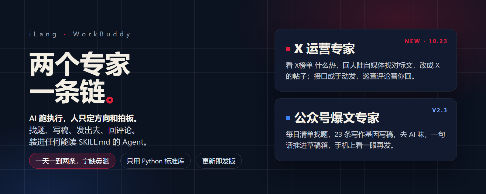
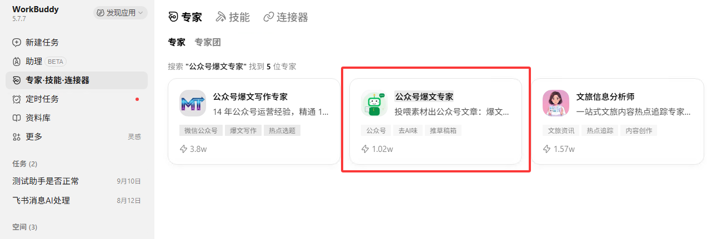

<p align="center">
  <picture>
    <source media="(max-width: 767px)" srcset="https://raw.githubusercontent.com/adsorgcn/WorkBuddy/main/docs/hero-mobile-2026-10-23.png">
    
  </picture>
</p>

<p align="center">
  <a href="README.en.md">English</a>&nbsp;&nbsp;·&nbsp;&nbsp;<a href="HOT-LIST.md">今日内容清单</a>&nbsp;&nbsp;·&nbsp;&nbsp;<a href="https://github.com/adsorgcn/WorkBuddy/releases">发布页</a>&nbsp;&nbsp;·&nbsp;&nbsp;<a href="UPDATES.md">更新记录</a>
</p>

<p align="center">
  <a href="https://github.com/adsorgcn/WorkBuddy/releases"></a>
  <a href="https://github.com/adsorgcn/WorkBuddy/actions/workflows/update-hot-list.yml"></a>
  <a href="LICENSE"></a>
</p>

<br>

**AI 跑执行，人只定方向和拍板。** 仓库里两个专家，各自一条链：找题、写稿、发出去、回评论。技能都是标准 `SKILL.md` 加 Python 标准库脚本，WorkBuddy、Claude Code、Codex、Muse、Hermes、OpenClaw、豆包，能读技能文件的 Agent 都能装。

| | X 运营专家 <sub>10 月 23 日新上</sub> | 公众号爆文专家 |
|---|---|---|
| 给⁠谁 | 想让 AI 跑 X（Twitter）账号的人 | 写公众号的人 |
| 找⁠题 | X榜单 公开榜看今天什么热，回公众号、知乎、B 站、抖音、小红书找对标文 | 每天自动拉的四十多个热点源，加 wxrank 的公众号真实阅读分享 |
| 它⁠做 | 改写成帖、发帖、巡查你帖子下的评论并回复 | 写稿、出封面提示词、推进草稿箱、回查数据 |
| 你⁠做 | 定位说一次；每条挑题、点头 | 定题、审稿、手机上点发 |
| 花⁠钱 | 手动发零成本；走接口新号充 5 送 5 | 只有 wxrank 额度，看一次榜 1 积分 |
| 装⁠法 | GitHub，任何能读 SKILL.md 的 Agent | WorkBuddy 国内市场一键，或任何 Agent |

<br>

## X 运营专家

给想用 AI 跑 X（Twitter）账号的人。你说清定位，它找题、写帖、发帖、巡查你帖子下的评论并回复；你只定方向和拍板。

**找题的逻辑**和公众号找对标一样，方向反过来：先看 [X榜单](https://xbangdan.com/) 今天什么在热、什么形态在爆，再回中国大陆的自媒体（公众号、知乎、B 站、抖音、小红书）找对标文，改成 X 上的帖子，图和视频直接用。选题数据先从 X榜单 的公开榜来（免费，脚本直接解析四个榜单页），再用仓库每天自动更新的免费清单补；X榜单 的 MCP 可选，要在它 30 天的库里细筛才用得上。

**发帖二选一**：走 X 官方接口花你自己的积分（普通帖 0.015 美元一条，带链接 0.20），或者脚本把文案送进浏览器编辑框你自己点，不花钱。评论巡查走官方接口，只回你自己帖子下的评论。

### 小白怎么用

第一次用之前，三件事：

1. 一个能读技能文件的 AI 助手：Claude Code、Codex、Muse、WorkBuddy 海外版都行。把下面「装法」里那条命令整段贴给它，它自己装，装完给你一份报告。
2. 决定发帖走哪条路。手动：不花钱，它把文案填进 X 的编辑框，你看一眼点发。接口：去 developer.x.com 建一个应用，权限选 Read and write，生成四个密钥，写进电脑上的 `~/.x-api.env` 四行；控制台充 5 美元，会送 5 美元；跑一次 `check`，看到「权限 read-write」就通了。先建成只读再改权限的，要重新生成 Access Token。
3. 告诉专家你的号讲什么、给谁看、中文还是英文。说一次就行。

之后每天就是这五步：

| 你说 | 它做 |
|---|---|
| **1**&nbsp;&nbsp;「⁠今⁠天⁠发⁠什⁠么⁠」 | 看 X榜单 今天什么热、什么形态在爆，再去公众号、知乎、B 站、抖音、小红书找对标文，给你 1 到 3 条候选，每条带对标文链接、可用的图和视频、角度、结尾的问题。你挑一条 |
| **2**&nbsp;&nbsp;不⁠用⁠说，挑⁠完⁠它⁠自⁠己⁠写 | 把对标文改成 X 的帖子，单帖或串帖：钩子开头、短句、一条一个点、结尾一个别人能一句话答的问题，图和视频直接拿；自动过一遍门：长度、链接、标记、和你发过的像不像。你看一眼 |
| **3**&nbsp;&nbsp;「⁠发⁠」 | 手动路：浏览器弹出填好的编辑框，你点发；接口路：发出去并回读一次，一条 0.015 美元，带链接 0.20 |
| **4**&nbsp;&nbsp;「⁠巡⁠查⁠」 | 把你帖子下的评论拉全、排好序，超过 30 条先给三句摘要；替你写好回复列出来，你点头就发；一条 0.010 美元，只回主动来找你的人，一人一条 |
| **5**&nbsp;&nbsp;「⁠s⁠t⁠a⁠t⁠u⁠s⁠」 | 报今天发了几条、回了几条、花了多少。一天一到两条，大事不限 |

### 花多少钱

| 路⁠线 | 成⁠本 |
|---|---|
| 手⁠动⁠发 | 零 |
| 接⁠口⁠发 | 新号充 5 美元送 5 美元，一共 10 美元；只回评论一个月 3 美元上下，能用三个月左右 |
| 选⁠题 | X榜单 公开榜免费，它的 MCP 可选 |

### 装法

一条命令。需要一个能读 SKILL.md 的 Agent：WorkBuddy 海外版、Claude Code、Codex、Muse 都行。新开一个会话，整段贴进去，它自己学、自己装、装完报告。只走 GitHub，不进 WorkBuddy 国内市场，国内网络连不上 x.com。

<details>
<summary><b>点开复制安装命令</b>　I-Lang 写的，带一行 IML 工作链，Agent 看不懂会先去读协议再回来</summary>

```
::ILANG::v5.0
[TYPE:command][PROJECT:x_awesome][TASK:learn_and_install][LANG:zh]
::STATE{@ORIGIN, protocol:iLang, spec:https://github.com/ilang-ai/ilang-spec, iml:https://github.com/ilang-ai/iml-protocol, canon:ilang.ai, note:这段是 I-Lang 命令 不是自然语言 看不懂先读 spec 的 README 再回来}
::STATE{@REPO, url:https://github.com/adsorgcn/WorkBuddy, readme:README.md, expert:experts/ilang-x-awesome/agents/ilang-x-awesome.md 开头两行 --- 之间是 WorkBuddy 的设置 其余是专家正文, skills:experts/ilang-x-awesome/skills/ 下三个文件夹 x-topic-hunter x-post x-comment-patrol 每个一份 SKILL.md 加 scripts 和 references, zip:https://github.com/adsorgcn/WorkBuddy/releases 最新版 ilang-x-awesome-workbuddy-expert 开头的 zip 跟仓库同内容}
::STATE{@SELF, role:learner_and_installer, runtime:你自己 不管你是哪个 Agent, can:读网页或 git clone 读文件 跑 shell 写文件, knows:你自己的技能目录在哪 你自己的人设文件是哪个 不知道就读你自己的文档 再不知道问我}
::STATE{@TARGET, skills:三个技能文件夹原样拷进你自己的技能目录, expert:专家正文放进你自己的人设文件或系统提示 设定里要能看到 [PROJECT:x_awesome], python:3.8 以上 脚本只用标准库 不装包}
::STATE{@OUT, kind:装完报告, items:技能装到了哪个目录 哪几个在技能列表里 专家正文放在哪 x_feed 读到的前 3 条}
#iml/0.5/7e29fae7f5ea GT@SR CK SN@DS CK $

::OBJECTIVE{learn_and_install|pri:OVERRIDE_ALL}
  target: 先读 @REPO 的 README 和三份 SKILL.md 学会这套东西怎么用 再把技能和专家装进你自己 装完自检 报告
  ACCEPT: 技能列表里能看到装进去的技能 设定里有 [PROJECT:x_awesome] 跑 x-topic-hunter 的 x_feed.py 能读到今天的清单
  NON_GOALS: 改包里任何文件 碰我的任何密钥 替我注册或付费 发任何帖子

::RULE{拿包⇒git clone 或下 @REPO 的 zip 都行 本机上不去 GitHub 就停下告诉我 我下好给你路径}
::RULE{桌面版 WorkBuddy 这类装不进文件的⇒告诉我去 Skills 面板上传技能 去专家页创建专家 把正文粘进去 名字 X运营专家}
::RULE{人设文件⇒专家正文整段放进去 不删不改 已经有别的人设就追加一段}
::BOUNDARY{never:改动包里任何文件的内容|scope:permanent}
::BOUNDARY{never:把任何 key 或口令写进对话|scope:permanent}

::MODULE{HOW}
  [STEP:1:LEARN] 读 README 和三份 SKILL.md 用三句话复述这条链怎么走 谁在什么时候拍板
  [STEP:2:GET] 拿包 列出专家正文和三个技能文件夹的路径
  [STEP:3:SKILLS] 装进你自己的技能目录 新会话看列表 报哪几个在
  [STEP:4:EXPERT] 把专家正文放进你的人设 报放在哪
  [STEP:5:CHECK] 跑 x_feed.py --n 3 报前 3 条
  [STEP:6:REPORT] 按 @OUT 报告 最后问我发帖走接口还是手动
```

</details>

没有任何运行环境的，先装一个能读 SKILL.md 的 Agent。教程关注 X 上的 [@ai_chuhai](https://x.com/ai_chuhai)，推荐先读两篇：[X 新手攻略](https://x.com/ai_chuhai/status/2112640526176358616)、[X 算法公式](https://x.com/ai_chuhai/status/2113358982391750858)。

### 它不做的

时政地缘不碰，点赞关注引用不做，不发热搜话题，不给陌生人的帖评论，不用脚本碰 X 网站，一天不超过两条，密钥不进对话不给任何人。

<br>

## 公众号爆文专家

市面上的「AI 写公众号」只管写。这里是一条链：每天自动更新的内容清单告诉你各平台在聊什么，公众号的真实阅读分享数据告诉你哪些题还没写爆，然后 AI 写稿、配图、推进草稿箱，你在手机上看一眼再发，发完它回查数据、给你排节奏。人只在两处拍板：定题，审稿。

以 WorkBuddy 为主（国内版市场里直接加），同时任何能读 `SKILL.md` 的 Agent 都能装：Claude Code、Codex、CodeBuddy 命令行、Hermes、OpenClaw、豆包、Muse 等。唯一要花钱的地方是 wxrank 的 API 额度，你自己去买：https://wxrank.com/api-services 。

### 跟别人不一样在哪

| | 常见的 AI 写公众号 | 这里 |
|---|---|---|
| 管⁠哪⁠段 | 写 | 选方向、找题、内容清单、写、配图、推草稿箱、回查、节奏，整条 |
| 找⁠题 | 你自己想，或者凭感觉 | 需求侧是仓库每天自动拉的四十多个热点源，供给侧是公众号上这个题读了多少、爆没爆，两边对上才是题 |
| 人⁠做 | 全程盯着 | 两次拍板：定题、审稿；发布永远人点 |
| 换⁠工⁠具 | 重来 | 技能是标准 SKILL.md 加标准库脚本，换个 Agent 照用 |
| 花⁠钱 | 平台会员、模型、工具各一份 | 只有 wxrank 的额度，100 积分 1 元，看一次榜 1 积分 |

### 玩法：一条链

| 步 | 干什么 | 用什么，交付什么 |
|---|---|---|
| 1 | **选⁠方⁠向**<br><sub>AI 比，你定</sub> | 选题技能 `direction`：给 2 到 8 个候选品类词，各看一次榜<br><sub>交付 · 一张表：命中篇数、最高阅读、中位阅读、10 万加篇数</sub> |
| 2 | **找⁠题**<br><sub>AI 找，你定</sub> | `feed` 读今日内容清单（免费），`hot` 看公众号上这个题的阅读分享<br><sub>交付 · 5 条候选题，每条带需求侧和供给侧数据</sub> |
| 3 | **内⁠容⁠清⁠单**<br><sub>AI 排</sub> | `calendar`：挑题、看榜、按周更节奏排日期<br><sub>交付 · 一个月的清单，带日期</sub> |
| 4 | **写⁠稿**<br><sub>AI 写</sub> | 写稿技能：23 条写作基因、12 项自查、去 AI 味<br><sub>交付 · MD 正文、3 个标题、封面提示词、自查报告</sub> |
| 5 | **配⁠图**<br><sub>AI 出提示词，图你出或接出图模型</sub> | 封面提示词模板<br><sub>交付 · 封面加正文图</sub> |
| 6 | **推⁠草⁠稿⁠箱**<br><sub>AI 推</sub> | 推草稿技能：转微信 HTML、传图、draft/add、回读核对<br><sub>交付 · 草稿箱里的那篇，media_id</sub> |
| 7 | **审⁠稿⁠发⁠表**<br><sub>你</sub> | 手机公众号助手<br><sub>交付 · 发出去的链接</sub> |
| 8 | **回⁠查**<br><sub>AI 查</sub> | `article` 查单篇阅读在看分享<br><sub>交付 · 每篇一行数据</sub> |
| 9 | **节⁠奏**<br><sub>AI 排，你定</sub> | 周更 1 到 2 篇，囤 2 到 3 篇再开<br><sub>交付 · 周计划</sub> |

每一步的输出是 I-Lang 块，贴进下一步的命令里就行。一台机器、一个 Agent 跑完整条链，手机遥控它。

### 怎么用

| 步 | 你说或你做 | 它⁠做 |
|---|---|---|
| 1 | 说「今天写什么」，或贴下面「今日内容清单」里那条每日命令 | 读清单、查数据，给 5 条题；你选一条，补一句独家 |
| 2 | 贴素材（经历、数据、笔记、文件路径），说「写成公众号爆文」 | 确认角度和骨架，你选 |
| 3 | 确认 | 出提纲和 3 个标题 |
| 4 | 审改：补个人经历、填口语位、补截图 | 写初稿，去 AI 味，12 项自查 |
| 5 | 说「推草稿箱」 | 转微信 HTML、传图、推进草稿箱；你在手机公众号助手里看一眼再发 |
| 6 | 发完把链接给它 | 查阅读在看分享，排下一篇 |

素材是别人的知识，文章是你的观点。没独家的题，专家会建议你不写。

### 装法

两条路。WorkBuddy 国内版去市场点一下；其他任何 Agent，包括 WorkBuddy 海外版，贴一条命令让它自己学、自己装。

#### WorkBuddy 国内版（主路线）

市场里搜「公众号爆文专家」，点下图红框那个。绿色小机器人头像，标签「公众号 去AI味 推草稿箱」。旁边那个「公众号爆文写作专家」不是。

<p align="center">
  
</p>

市场版自带写稿和推草稿两个技能。选题技能市场里没有，从 [发布页](https://github.com/adsorgcn/WorkBuddy/releases) 下 `wechat-topic-hunter` 开头的 zip，解压后在 Skills 面板「上传技能」选那个文件夹，再分配给专家。

#### 其他任何 Agent：一条命令，它自己学、自己装

Claude Code、Codex、CodeBuddy 命令行、Hermes、OpenClaw、豆包、Muse、WorkBuddy 海外版，还有以后出的，都是这一条。新开一个会话，整段贴进去。它会先读仓库学会这套东西怎么用，再把技能拷进它自己的技能目录、把专家正文放进它自己的人设，装完自检报告。它自己装不了的那一步（比如桌面版要在界面上传）会告诉你点哪里。

<details>
<summary><b>点开复制安装命令</b>　这段本身就是 I-Lang 写的，带一行 IML 工作链，Agent 看不懂会先去读协议再回来；读完它就会读本仓库里所有的块</summary>

```
::ILANG::v5.0
[TYPE:command][PROJECT:wechat_awesome][TASK:learn_and_install][LANG:zh]
::STATE{@ORIGIN, protocol:iLang, spec:https://github.com/ilang-ai/ilang-spec, iml:https://github.com/ilang-ai/iml-protocol, canon:ilang.ai, note:这段是 I-Lang 命令 不是自然语言 看不懂先读 spec 的 README 再回来}
::STATE{@REPO, url:https://github.com/adsorgcn/WorkBuddy, readme:README.md, expert:experts/ilang-wechat-awesome/agents/ilang-wechat-awesome.md 开头两行 --- 之间是 WorkBuddy 的设置 其余是专家正文, skills:experts/ilang-wechat-awesome/skills/ 下四个文件夹 每个一份 SKILL.md 加 scripts 和 references, feed:data/hot/latest.json 每天自动更新的内容清单, zip:https://github.com/adsorgcn/WorkBuddy/releases 最新版 ilang-wechat-awesome-workbuddy-expert 开头的 zip 跟仓库同内容}
::STATE{@SELF, role:learner_and_installer, runtime:你自己 不管你是哪个 Agent, can:读网页或 git clone 读文件 跑 shell 写文件, knows:你自己的技能目录在哪 你自己的人设文件是哪个 不知道就读你自己的文档 再不知道问我}
::STATE{@TARGET, skills:四个技能文件夹原样拷进你自己的技能目录 装不下的至少装 wechat-article wechat-draft-push wechat-topic-hunter, expert:专家正文放进你自己的人设文件或系统提示 设定里要能看到 [PROJECT:wechat_awesome], python:3.8 以上 脚本只用标准库 不装包}
::STATE{@OUT, kind:装完报告, items:技能装到了哪个目录 哪几个在技能列表里 专家正文放在哪 自检五项}
#iml/0.5/7e29fae7f5ea GT@SR CK SN@DS CK $

::OBJECTIVE{learn_and_install|pri:OVERRIDE_ALL}
  target: 先读 @REPO 的 README 和四份 SKILL.md 学会这套东西怎么用 再把技能和专家装进你自己 装完自检 报告
  ACCEPT: 技能列表里能看到装进去的技能 设定里有 [PROJECT:wechat_awesome] 跑选题技能的 feed 命令能读到今天的清单
  NON_GOALS: 改包里任何文件 碰我的任何密钥 替我注册或付费

::RULE{拿包⇒git clone 或下 @REPO 的 zip 都行 本机上不去 GitHub 就停下告诉我 我下好给你路径}
::RULE{技能目录⇒你自己的文档说在哪就放哪 放完新开一个会话看技能列表 看不到就告诉我在界面上怎么传}
::RULE{桌面版 WorkBuddy 这类装不进文件的⇒告诉我去 Skills 面板上传技能 去专家页创建专家 把正文粘进去 名字 公众号爆文专家}
::RULE{人设文件⇒专家正文整段放进去 不删不改 已经有别的人设就追加一段}
::BOUNDARY{never:改动包里任何文件的内容|scope:permanent}
::BOUNDARY{never:把任何 key 或口令写进对话|scope:permanent}

::MODULE{HOW}
  [STEP:1:LEARN] 读 README 和四份 SKILL.md 用三句话复述这条链怎么走 谁在什么时候拍板
  [STEP:2:GET] 拿包 列出专家正文和四个技能文件夹的路径
  [STEP:3:SKILLS] 装进你自己的技能目录 新会话看列表 报哪几个在
  [STEP:4:EXPERT] 把专家正文放进你的人设 报放在哪
  [STEP:5:CHECK] 跑选题技能 feed 读今天的清单 报前 3 条 再跑 README 里「装完自检」那段 五项各一行
  [STEP:6:REPORT] 按 @OUT 报告 最后告诉我下一步贴什么
```

</details>

它要是问技能目录在哪，常见位置：Claude Code `~/.claude/skills/`，Codex `~/.codex/skills/`，CodeBuddy 命令行 `~/.codebuddy/skills/`，Hermes `~/.hermes/skills/`，OpenClaw `~/.openclaw/skills/` 或工作区 `skills/`；人设文件对应 `CLAUDE.md`、`AGENTS.md`、`CODEBUDDY.md`、`SOUL.md`。豆包在技能页「自定义新建技能」把 `SKILL.md` 内容贴进去，Muse Code 认标准 `SKILL.md` 目录。海外版 WorkBuddy 的自定义模型只认 OpenAI 兼容接口。界面上的字以你看到的为准，装错了它自己会纠。

#### 唯一要花钱的：wxrank

供给侧的数据来自 wxrank（微小榜）的公众号接口，用你自己的 key。买额度：https://wxrank.com/api-services ，注册和充值：https://data.wxrank.com ，100 积分等于 1 元，看一次榜 1 积分，日上限默认 300 积分。key 写进用户主目录的 `.wxrank.env`，一行 `KEY=你的key`，脚本自己读，不要贴进任何对话。

接口哪台机器都能连，国内海外都一样，我们从十四台不同地区的机器上测过。连不上是你那台机器自己的网络问题。

可选的第二笔钱：封面和配图想让 AI 直接出，接一个 OpenAI 兼容的出图接口，比如 apikey.fun 的 gpt-image-2。不接也行，专家会给你封面提示词，你自己出图。

#### 装完自检

切进专家的对话，整段贴进去。

<details>
<summary><b>点开复制自检命令</b>　五项各一行：专家、模型、技能文件、技能绑定、wxrank</summary>

```
::ILANG
[TYPE:command][PROJECT:wechat_awesome][TASK:env_check][LANG:zh]

::STATE{@USER, role:owner}
::STATE{@SELF, role:checker, runtime:专家对话, can:Read Bash Glob}
::STATE{@OUT, kind:自检报告, items:五项 专家 模型 技能文件 技能绑定 wxrank}

::OBJECTIVE{env_check|pri:OVERRIDE_ALL}
  target: 核五项 缺的告诉我怎么补 能跑的自己跑
  ACCEPT: 五项各一行 有 或 缺 最后一行 全部就绪 或 还缺几项
  NON_GOALS: 替我填任何密钥 猜没核过的状态

::RULE{检查靠跑命令或读文件⇒不靠猜 跑不了的写 没核到}
::RULE{密钥⇒只看文件在不在 不读内容 不复述}

::MODULE{HOW}
  [STEP:1] 看你自己的设定里有没有 [PROJECT:wechat_awesome] 有就报 VERSION 后面的版本号 没有写 缺
  [STEP:2] 一句话证明模型在回话 说清用的是自带模型还是自定义模型
  [STEP:3] Glob 找 **/wechat-article/SKILL.md **/wechat-draft-push/scripts/wechat_draft.py **/wechat-topic-hunter/scripts/wxrank_topics.py 在下载目录或桌面的不算 那只是包
  [STEP:4] 看本对话能用的技能列表里有没有这三个
  [STEP:5] 用户主目录有没有 .wxrank.env 有就跑选题技能的 balance 报余额 没有写 缺
  [STEP:6] 五项各一行 项目 有或缺 怎么补
```

</details>

安装非官方技能前，先看一遍源码和权限。这里的脚本都是纯 Python 标准库、凭据从本机配置文件读：推草稿技能的 `wechat_draft.py` 只调微信官方接口，发布命令只在人说「发」之后对认证号可用，没有删草稿命令；选题技能的 `wxrank_topics.py` 只读调用 wxrank，花积分前报价；`hot_sources.py` 只读公开的 RSS 和接口。

### 它不做的事

- 没素材不写
- 不编数字、引语、个人经历
- 不引导点赞转发收藏关注
- 不在文章里放网址和个人微信号
- 不碰政治、赌博、色情、翻墙类话题
- 不做矩阵号、批量操作、搬运洗稿
- 不自动发布：发布永远人点，或人说「发」之后认证号由接口点最后那一下
- 不用于规避各平台对 AI 辅助内容的披露要求

<br>

## 今日内容清单，每天自动更新

[HOT-LIST.md](HOT-LIST.md) 是人读的，`data/hot/latest.json` 是机器读的，每天北京时间早上六点半由 GitHub Actions 自动跑：拉八十多个公开热点源（中、英、日、韩：知乎、微博、抖音、百度、B 站、头条、澎湃、贴吧、参考消息、36 氪、金十、财联社、IT 之家、量子位、少数派、V2EX、HN、Product Hunt、TechCrunch、BBC、ITmedia、韩联社、Google Trends 七个地区等；源每天自动增减，当前数量见 HOT-LIST.md 开头），跨平台聚类，同一件事几个平台在聊标出来，按 AI、科技、热榜、财经、产品、海外、热搜词七个方向分组，每个方向 15 条，72 小时内的在前。

源也是自动管的：候选池里能拉到东西、而且这个平台还没有源的，自动加进来；连续 7 天拉不到的自动下线，哪天通了自动恢复。每次增减写在 [UPDATES.md](UPDATES.md)。

你的 Agent 每天一条命令就能拿到清单，不用自己去爬。

<details>
<summary><b>点开复制每日命令</b>　贴给装好公众号专家的 Agent</summary>

```
::ILANG
[TYPE:command][PROJECT:wechat_awesome][TASK:daily_topics][LANG:zh]

::STATE{@FEED, url:https://raw.githubusercontent.com/adsorgcn/WorkBuddy/main/data/hot/latest.json, what:今天各平台在聊什么 按方向分组 platforms 是几个平台同时在聊}
::STATE{@USER, niche:<你的品类词 一到三个>}
::STATE{@SELF, skill:wechat-topic-hunter}

::OBJECTIVE{daily_topics|pri:OVERRIDE_ALL}
  target: 用 feed 读 @FEED 挑出跟我品类有关的 5 条 再用 hot 查每条在公众号上的阅读和分享 给我一份带两边数据的选题清单
  ACCEPT: 5 条 每条有来源 平台数 公众号最高阅读 篇数 还没写爆的标出来 独家栏空着我填
  NON_GOALS: 替我定题 搬运原文 没报价就扣积分
```

</details>

仓库自己的节奏：

- 每天北京时间 06:30 自动跑一次：把四十多个信息源拉一遍，重写今日内容清单，[HOT-LIST.md](HOT-LIST.md) 给人看，`data/hot/latest.json` 给 Agent 读。
- 信息源自己长：候选池里哪个源能拉到东西、而且这个平台还没有，就自动加进 `sources.json`；连续 7 天拉不到的自动下线，哪天通了自动恢复。每次增减写进 [UPDATES.md](UPDATES.md)。
- 一有更新就发版：版本号升一个小号、过门禁、打 zip、建 release，发版说明自动写这次改了什么、今天的清单多少条。发布页天天有新版，装最新的就行。
- 你的 Agent 不用自己爬任何东西，读 `latest.json` 这一个文件就够；上不去 GitHub 的机器，选题技能里带的 `hot_sources.py` 能自己拉同一批源。

门禁：版本一致、frontmatter 齐、IML 工作链用官方编译器回环、无长破折号、无效果承诺、引用文件齐、脚本能编译。没过不发版。

<br>

## 技能清单

| 名称 | 是什么 | 版本 |
|---|---|---|
| [X⁠运⁠营⁠专⁠家](experts/ilang-x-awesome/)<br><sub>ilang-x-awesome</sub> | 专家正文。说清定位，它找题、写帖、发帖、巡查评论并回复，你定方向和拍板；一天一到两条，时政地缘不碰，不用脚本碰 X 网站。带下面三个技能 | 2.3.47 |
| [X⁠ ⁠选⁠题](experts/ilang-x-awesome/skills/x-topic-hunter/)<br><sub>x-topic-hunter</sub> | 先 `x_rank.py` 读 X榜单 公开榜（24 小时最火推文、话题榜、长文榜、海外榜，免费）看什么热，再到大陆自媒体（公众号、知乎、B 站、抖音、小红书）找对标文；`x_feed.py` 读仓库免费清单兜底；都按 X 口径过滤：禁区、时效、语言、和你发过的去重。X榜单 MCP 可选。只读 | 2.3.47 |
| [X⁠ ⁠发⁠帖](experts/ilang-x-awesome/skills/x-post/)<br><sub>x-post</sub> | `x_api.py`：check 验密钥，gate 过门（加权 280、无标记、无长破折号、正文无链接、不重复、一天两条），post 单帖，thread 串帖，`--media` 带图或视频，intent 开浏览器编辑框你自己点。接口路发完回读，正文全文记本机日志 | 2.3.47 |
| [X⁠ ⁠评⁠论⁠巡⁠查](experts/ilang-x-awesome/skills/x-comment-patrol/)<br><sub>x-comment-patrol</sub> | `x_patrol.py`：fetch 按水位线拉你帖子下的新评论交给专家判，send 发专家写好的回复并推进水位线，status 看花费。只回召唤你的人，一轮最多 20 条，回复里不放链接 | 2.3.47 |
| [公⁠众⁠号⁠爆⁠文⁠专⁠家](experts/ilang-wechat-awesome/)<br><sub>ilang-wechat-awesome</sub> | 专家正文。投喂素材，按 200 多篇实战文章验证的写作基因重组，出 MD 正文、3 个标题、封面图提示词；没素材不写，不编数字不编经历。带下面四个技能 | 2.3.47 |
| [选⁠题⁠对⁠标](experts/ilang-wechat-awesome/skills/wechat-topic-hunter/)<br><sub>wechat-topic-hunter</sub> | `feed` 读每日清单（免费），`direction` 比方向，`calendar` 排内容清单，`hot` 看榜，找号、对标、单篇数据；每次花积分前先报价。附 `hot_sources.py`，上不了 GitHub 时自己拉热点源 | 2.3.47 |
| [写⁠稿](experts/ilang-wechat-awesome/skills/wechat-article/)<br><sub>wechat-article</sub> | 23 条写作基因，六段式和八区块两种骨架，标题四个公式，12 项自查，去 AI 味三件套和五个信号，脱敏表和敏感词红线，封面提示词模板 | 2.3.47 |
| [推⁠草⁠稿⁠箱](experts/ilang-wechat-awesome/skills/wechat-draft-push/)<br><sub>wechat-draft-push</sub> | check 验凭据和白名单，render 转微信 HTML，push 传图传封面推进草稿箱并回读，verify 回读，publish 只在人看完草稿说「发」后对微信认证号可用。外链自动收进文末「参考链接」，留言开关和「阅读原文」可设。贴图：newspic_cards.py 把带【第N页】的稿子出成 1080×1440 卡片图，push-newspic 推成图片消息草稿。没有删草稿命令 | 2.3.47 |
| [远⁠程⁠派⁠活](experts/ilang-wechat-awesome/skills/remote-dispatch/)<br><sub>remote-dispatch</sub> | 可选件。两台机器的人用：本机当总控，把 [RUN:VPS] 的命令块派给远程机上的 CodeBuddy 网关跑，收回结果。远程机起网关的脚本在 scripts 里，Linux 和 Windows 各一个 | 2.3.47 |

<br>

## 协议

专家正文和技能用 iLang 协议写，开头那行 `#iml/0.5/...` 是它的机器层 IML 0.5 工作链，用官方编译器回环验证过：

```
[PARS:@USER]=>[GET:@SRC]=>[DRFT|sty=casual]=>[CHEK]=>[SAVE:@DST|grp=date]=>[Ω]
#iml/0.5/7e29fae7f5ea PS@US GT@SR DRst=casual CK SV@DSgr=date $
```

| 资源 | 地址 |
|---|---|
| iLang 官网 | ilang.ai |
| iLang 中文站 | ilang.cn |
| 公众号排版工具 | ilang.cn/md |
| 协议正典 | github.com/ilang-ai/ilang-spec |
| 机器层 IML | github.com/ilang-ai/iml-protocol |

<br>

## 更新记录

每日清单的增减在 [UPDATES.md](UPDATES.md)，每个版本改了什么在 [发布页](https://github.com/adsorgcn/WorkBuddy/releases)。最近几版：

- 2.3.42（2026-10-23）：横幅加手机版：窄于 768 像素时换 4:5 的竖版图，卡片文字在手机上看得清；英文同步。
- 2.3.41（2026-10-23）：README 改版：新横幅，X 运营专家放最前，两个专家一张对照表，小白五步改成表格，安装命令和自检命令收进折叠块，更新记录只展开最近几版；英文 README 同步。
- 2.3.40（2026-10-23）：README 的 X 一节加「小白怎么用」：第一次用的三件事、五步、花多少钱、不做的事；英文 README 同步。
- 2.3.39（2026-10-23）：X 选题改成和公众号一样的找对标逻辑：X榜单 看今天什么热，再到大陆自媒体找对标文，交给 x-post 改写（文字重切，图视频直接拿）；x_api.py 加 `--media` 传图和视频（v2 媒体接口，没实测）；写进搬运被封的申诉话术。
- 2.3.38（2026-10-23）：选题第一源改成 X榜单 公开榜：新脚本 `x_rank.py` 直接解析 /posts/ /words/ /articles/ /global/ 四个页面（免费，不用 MCP 不用账号），MCP 降为可选；禁区词表去掉「香港」「独立」「教会」「统一」「民族」「国防」这类误拦常用词，换成港独、独立运动、民族主义、国防部等组合。
- 2.3.37（2026-10-23）：巡查按大逻辑改：一条帖几百条回复的号，fetch 按页翻页拉全（默认 300 条），按值得先看的顺序排好（帖下评论优先、作者粉丝数、带链接和几个字的垫底），超过 30 条先给三句摘要再挑着回。
- 2.3.36（2026-10-23）：按实测改两句：新号充 5 送 5 一共 10 美元、只回评论能用三个月左右；链接走接口回自己的帖不算召唤照样 0.20，省钱走手动或放简介。
- 2.3.35（2026-10-23）：巡查回复不设申请门槛：撤掉「没批准前只拟不发」，回自己帖下的评论按原流程发。
- 2.3.33（2026-10-23）：X 专家按外部验收回包修十几处：check 打印 App 权限并在只读时提醒（真发 403 的根因）；403 解释先指向 App 权限；互动一次只回一条；清单时效按北京时间算，机器在哪都一样；禁区词表加缩写复数和中办国办，「冲突」只拦政治组合；通过数和显示数分开打印；intent --no-open 不再说「编辑框已填好」；status 显示读的花费和 App 权限、没 check 时提示；fetch 拉满提示还有更早的；同一条评论回两次单独报；文档统一说明 python3。
- 2.3.31（2026-10-22）：新增第二个专家「X运营专家」ilang-x-awesome 和三个技能：x-topic-hunter（X榜单 MCP 或仓库免费清单，按 X 口径过滤，时政地缘六类禁区）、x-post（`x_api.py` 标准库 OAuth 1.0a：check / gate / post / thread / reply / mentions，发帖二选一，接口花自己的积分或 intent 开编辑框手动点）、x-comment-patrol（`x_patrol.py` 按水位线拉自己帖下的新评论，专家判，接口回复，只回召唤自己的人）。门禁和发版脚本改成遍历 experts/ 下所有专家，每个专家和每个技能各出一个 zip。

<details>
<summary>更早的版本</summary>

- 2.3.24（2026-10-16）：推草稿箱加贴图（图片消息）：`newspic_cards.py` 把带【第N页】标记的稿子用本机 Edge/Chrome 无头截成 1080×1440 卡片图并逐张校验，放不下报错不缩字；`push-newspic` 过门后把图传成永久素材、推成图片消息草稿、回读标题。draft/add 发出去没收到回复不再当失败：落 `*-UNKNOWN-<时间>.json`、退出码 3，先看草稿箱再决定重不重推。`render` 顺带写 390 宽的 `*.preview.html`。引用块认 GFM 提示块 `> [!NOTE|TIP|IMPORTANT|WARNING|CAUTION]`，出四色信息卡。
- 2.3.18（2026-10-12）：推草稿箱默认在自己电脑上跑：脚本强制 IPv4；白名单填本机当前公网 IP，IP 变了再加一次，白名单能存多个；借远程机 IP 的隧道改成备选。
- 2.3.14（2026-10-10）：按两份外部检测报告修。清单：一条坏源不再拖死整轮；72 小时内的在前、多平台优先再按新旧，相对时间（22分钟前）、只有日期、带时区的时间都归到北京时间，备用源不再和主源同时出现；聚类加三道闸：跌破/突破这类相反说法不合并、四字以内的短名只在完全相同时合并、GPT-4 和 GPT-5 这种连字符版本号不合并。选题：`feed` 显示发布时间；`calendar` 每周篇数算准、参数错在扣积分之前就报；`benchmark` 只查每次推送的头条。推草稿箱：行内代码里的星号不再排版、表头链接只引一次、英文软换行补空格、标题列表引用表格里的行内图片也只留说明。派活：流中断不再抛栈、回退找会话用原正文。发版：同步版本号不再误伤更长的版本号、dry-run 不再丢未提交改动、技能正文的版本标签一起同步。门禁加回归测试（`scripts/test_quality.py`）、Actions 里缺 IML 编译器算失败、没装 PyYAML 也能跑；三个 http 源改 https。
- 2.3.6（2026-10-10）：改成任何 Agent 都能装的公众号全链路。新增每日内容清单（`data/hot/latest.json`、`HOT-LIST.md`，Actions 每天自动拉四十多个源、跨平台聚类、自动加源和下线）和更新即发版；选题技能加 `feed`（免费读清单）、`direction`（方向比较）、`calendar`（内容清单）三个命令，热点源脚本并入选题技能；任何 Agent 一条 I-Lang 命令自己学自己装（内置 IML 工作链），写明唯一要花钱的是 wxrank 额度、接口哪台机器都能连。
- 2.3.5（2026-10-09）：远程派活补齐远程机那一半：`setup-gateway.sh`（Linux）和 `setup-gateway.ps1`（Windows）一键起 CodeBuddy 网关；派出正文前加 `::NOTE{via:remote-dispatch …}`；允许本机按用户指明填 [FILL] 行。
- 2.3.4（2026-10-09）：推草稿箱：外链收进文末「参考链接」（`--no-cite` 关）；`--comment`、`--source-url`；`tunnel` 子命令借远程机 IP 过白名单；错误码表补全。写稿自查加「AI 味五个信号」。
- 2.3.3（2026-10-09）：新增远程派活技能 remote-dispatch。
- 2.3.2（2026-10-09）：安装说明分国内版和海外版，加「装完自检」。
- 2.3.1（2026-10-09）：专家改名「公众号爆文专家」。
- 2.3.0（2026-10-09）：新增选题对标技能 wechat-topic-hunter，用用户自己的 wxrank key。
- 2.2.0（2026-10-09）：推草稿箱技能加 publish 命令，只在人看完草稿说「发」后对认证号可用。
- 2.1.0（2026-10-08）：新增推草稿箱技能。
- 2.0.0（2026-10-08）：从国内市场版 1.2.0 升级，基因 23 条，内置去 AI 味，iLang v5.0 头加 IML 0.5 工作链。
- 1.2.0（2026-09-02）：国内 WorkBuddy 市场上架版。

</details>

<br>

<p align="center"><sub>MIT · © 2026 静水流深 · <a href="https://ilang.ai">ilang.ai</a></sub></p>
